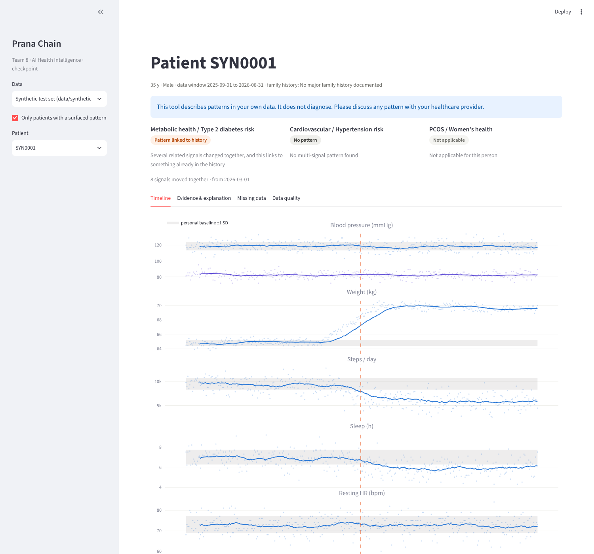

# Prana Chain · AI Health Intelligence — Team 8 (checkpoint, week 6)

COMP 8967 · Business 2: Prana Chain · Team 8: Uday Kumar Reddy Yarradoddi (lead) · Sneha Gunturu · Sindhu Padmaja Dudekula · Gavinnolla Tanusree Reddy

**Status: 4 of 10 work packages done (≈ 40 % of the project).** This repository holds the working core: one patient's
12-month workbook → cleaned single timeline → each signal compared with the person's own baseline → a pattern only when
several related signals change together → linked to the history → evidence, plain-language explanation and missing-data
requests on a dashboard. It never diagnoses. The remaining work is planned in [`docs/PLAN_AND_DISCUSSION.md`](docs/PLAN_AND_DISCUSSION.md).



## Run it on your laptop
Full step-by-step guide for Windows and macOS (with troubleshooting): **[`docs/RUN_GUIDE.md`](docs/RUN_GUIDE.md)**. Short version:

```bash
python -m venv .venv
# Windows:  .venv\Scripts\activate      macOS/Linux:  source .venv/bin/activate
pip install -r requirements.txt
# Windows PowerShell:  $env:PYTHONPATH="src"      macOS/Linux:  export PYTHONPATH=src
python -m prana.data.generate_synthetic --n 120 --out data/synthetic
python scripts/run_pipeline.py --data data/synthetic
python scripts/validate.py --data data/synthetic
python scripts/serve.py                 # the patient portal, http://localhost:8000 ("Try the sample record" needs no account)
```
Demo walkthrough: [`docs/DEMO_GUIDE.md`](docs/DEMO_GUIDE.md).

## The patient portal (PranaSync)
Each patient signs in with their own ID and password and sees only their own record and analysis: an overview with a plain-language
or clinician reading, a year-by-signal map against their personal baseline, timeline, labs and cycles, medications and adherence,
history, what data would help, data quality, and how the method works. No uploads; the portal reads the patient's own workbook.

```bash
python scripts/create_users.py          # once: one account per workbook, random 12-character passwords -> data/users.json (hashes) + data/credentials_ISSUE_ONCE.csv
python scripts/serve.py                 # http://localhost:8000
```
Security model (prototype): scrypt-hashed passwords, signed HttpOnly session cookie, the patient taken from the session never the URL,
5-failure lockout, `no-store` on every API response, sign-out after 20 idle minutes. Hand out `credentials_ISSUE_ONCE.csv`, then delete it
(all three files are git-ignored). Behind real TLS set `https_only=True` in `server.py`; a production deployment should use the platform's
identity provider with MFA. `scripts/create_users.py --reset PC0042` issues a new password. Code: `web/` (plain ES modules, no build) and
`src/prana/api/`.

**Own baseline and reference values.** Patterns are found only against the person's own first 60 days. A separate layer then shows where each recent level sits against published reference ranges and the lab's own range, including levels that are steady but outside the usual range. Details, sources and open questions for the clinician: [`docs/REFERENCE_VALUES.md`](docs/REFERENCE_VALUES.md). AI-written suggestions are planned for the coming weeks (same document).

## Checkpoint results (120 test workbooks in the real 11-sheet layout, planted ground truth)

| | Our method | Simple high/low threshold alert |
|---|---|---|
| Precision / recall, all three areas | **0.98 / 1.00** | 0.41 / 0.98 |
| People with no planted pattern who got flagged | **0 %** | 80 % |
| Linked to history correctly | **100 %** (60 / 60) | – |
| Asked for the data we removed | **100 %** (12 / 12) | – |
| Explanations with diagnosis or alarm wording | **0 / 303** | – |

These are our own planted patterns, so they show the pipeline works end to end, not clinical accuracy.
Full report: `results/validation_report.md` (created by `scripts/validate.py`).

## What is in this checkpoint, and who owns it

| Part | Files | Owner |
|---|---|---|
| Repo setup, CI, dashboard | `README.md`, `requirements.txt`, `.github/` | Tanusree |
| Data: mapping, generator, loader & cleaning, timeline, SQLite DB, profiling | `config/column_map.yaml`, `src/prana/data/` | Sneha |
| Analysis: personal baseline, trend test, change point, multi-signal patterns | `config/scenarios.yaml`, `src/prana/analysis/` | Sindhu |
| Insight: history linking, evidence pack, missing data, template explanation, pipeline | `src/prana/insight/`, `scripts/run_pipeline.py` | Uday |
| Validation and docs | `scripts/validate.py`, `docs/` | everyone |

How each person pushes their part: [`docs/TEAM_GITHUB_PLAN.md`](docs/TEAM_GITHUB_PLAN.md).

## Not in this checkpoint (planned, see the plan document)
Run on all 900 real workbooks · tuning with Prana Chain's feedback · PostgreSQL for the full cohort · REST API ·
adherence and habits as signals · medication-aware baseline · "add missing data and re-run" · LLM wording through a
HIPAA-eligible service with output checks · cohort and validation pages · 4th health area as configuration only ·
fairness and sensitivity analysis · handoff documentation.

## Privacy
Patient workbooks (`data/raw/`), generated data, the database and `.env` are git-ignored and must never be committed.
