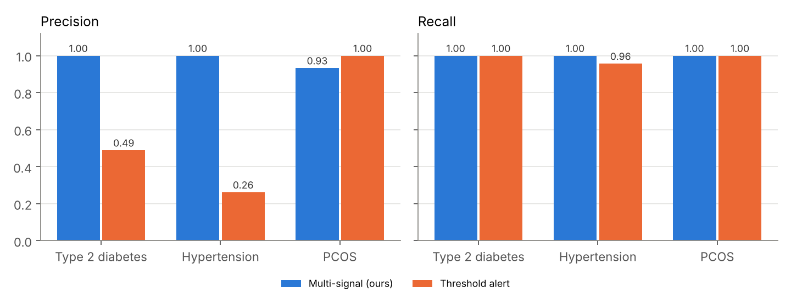
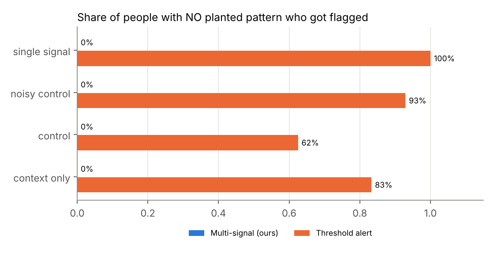
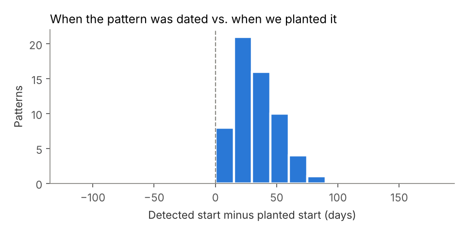

# Validation report (version 1)

Generated by `scripts/validate.py` on 120 synthetic workbooks with the real Prana Chain sheet layout and planted ground truth. Real workbooks have no labels, so accuracy can only be measured here; see `docs/VALIDATION.md` for how to read these numbers.

## 1. Pattern detection vs. a threshold alert

| Scenario / method | Precision | Recall | Specificity | F1 | TP | FP | FN |
|---|---|---|---|---|---|---|---|
| t2d - multi-signal (ours) | 1.00 | 1.00 | 1.00 | 1.00 | 23 | 0 | 0 |
| t2d - threshold alert | 0.49 | 1.00 | 0.75 | 0.66 | 23 | 24 | 0 |
| htn - multi-signal (ours) | 1.00 | 1.00 | 1.00 | 1.00 | 23 | 0 | 0 |
| htn - threshold alert | 0.26 | 0.96 | 0.36 | 0.41 | 22 | 62 | 1 |
| pcos - multi-signal (ours) | 0.93 | 1.00 | 0.98 | 0.97 | 14 | 1 | 0 |
| pcos - threshold alert | 1.00 | 1.00 | 1.00 | 1.00 | 14 | 0 | 0 |
| **all - multi-signal (ours)** | 0.98 | 1.00 | 1.00 | 0.99 | 60 | 1 | 0 |
| **all - threshold alert** | 0.41 | 0.98 | 0.65 | 0.58 | 59 | 86 | 1 |

## 2. False alarms on people with no planted pattern

Flagged at least once: **0% with our method vs 80% with a threshold alert.**

| Group | Ours | Threshold alert |
|---|---|---|
| context_only | 0% | 83% |
| control | 0% | 62% |
| noisy_control | 0% | 93% |
| single_signal | 0% | 100% |

## 3. Timing

Median detected start vs. planted start: **+32 days** (IQR +20 to +44); 92% within 60 days (n=60).

## 4. Linking to history

For correctly surfaced patterns, 'linked to history' matched the truth in **100%** of cases (n=60). Drift without any history finding was correctly reported as *not linked* in 10/10 cases.

## 5. Missing data

In 100% of the 12 patients where we removed data, the system asked for every removed item. By variant: {'no_hormone_labs': 1.0, 'no_recent_hba1c': 1.0, 'sparse_wearable': 1.0}.

## 6. Robustness: whole wearable sheet removed

Still surfaced (by scenario): {'htn': 1.0, 't2d': 0.857}. Asked the user for wearable data: 100% (n=29).
Blood pressure comes from the Vitals sheet, so hypertension does not depend on the wearable; without it the diabetes pattern has to rest on weight + labs, so some subtle cases drop below 3 signals.

## 7. Guardrails

303 explanations checked: 0 contained banned wording; 100% carried the disclaimer.

Wording is template-only in this checkpoint (LLM wording is planned for week 7).

## 8. Every error, for the limitations section

| Patient | Archetype | Scenario | Truth | Ours | Status |
|---|---|---|---|---|---|
| SYN0011 | t2d | pcos | False | True | pattern_no_context |
